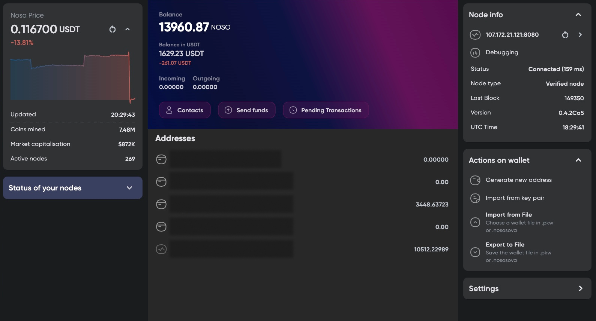

# 🦉 SovaWallet

Multi-platform wallet for [NosoCoin](https://nosocoin.com), built with Flutter.

> **About this repository.** SovaWallet was designed and implemented by me ([@pasichDev](https://github.com/pasichDev)) for the Noso Project.
> This repo is my own copy (fork) of [Noso-Project/sovawallet](https://github.com/Noso-Project/sovawallet/), kept here so the work isn't lost.



## Features

- Create / import a wallet, manage multiple addresses
- Send and receive NOSO, QR codes for addresses (generate and scan)
- Transaction history, coin price and market info
- Contacts (address book)
- Masternode details for your own nodes
- Active exchanges, own and all GVTs
- Automatic wallet backup, export / import of wallet files
- Dark and light theme
- Localization: English, Ukrainian, German, Spanish, Portuguese, Dutch, Russian, Chinese

Full history: [CHANGELOG.md](CHANGELOG.md).

## Platforms

Android · iOS · Windows · macOS · Linux

## Tech stack

- Flutter / Dart (SDK ≥ 3.0.6)
- State management: `flutter_bloc`
- Local storage: `drift` + SQLite, `shared_preferences`
- DI: `get_it`
- Direct TCP connection to Noso nodes, `http` for market data

```
lib/
  blocs/         – BLoC state management
  database/      – drift schema and DAOs
  models/        – data models
  repositories/  – data access layer
  services/      – node communication, backup, etc.
  ui/            – screens and widgets
  l10n/          – translations
```

## Build

```bash
flutter pub get
flutter run                # on a connected device / desktop
flutter build apk          # Android
flutter build windows      # or macos / linux / ios
```

## License

[MIT](LICENSE) © 2024 Noso Project
